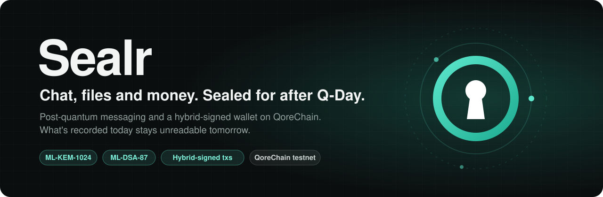
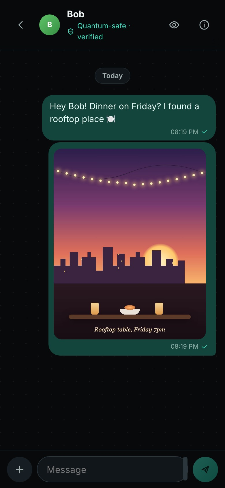
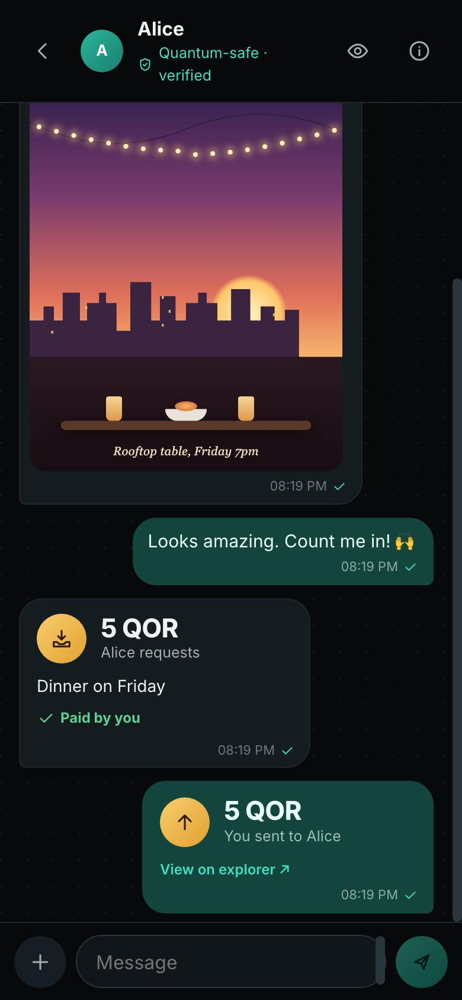
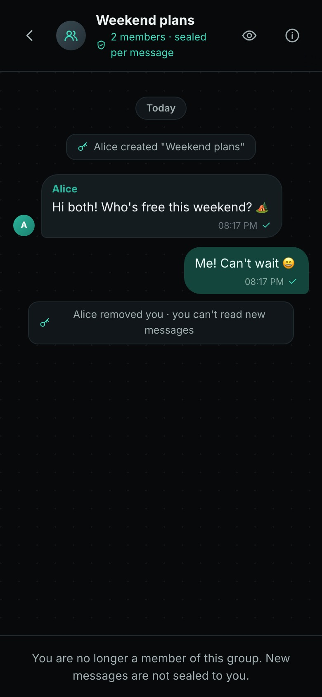
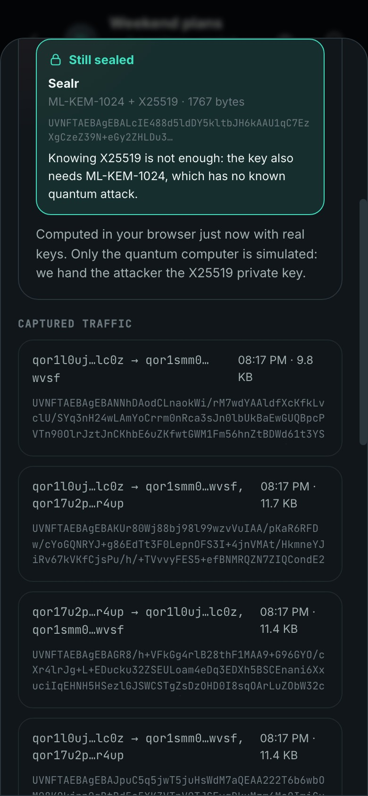
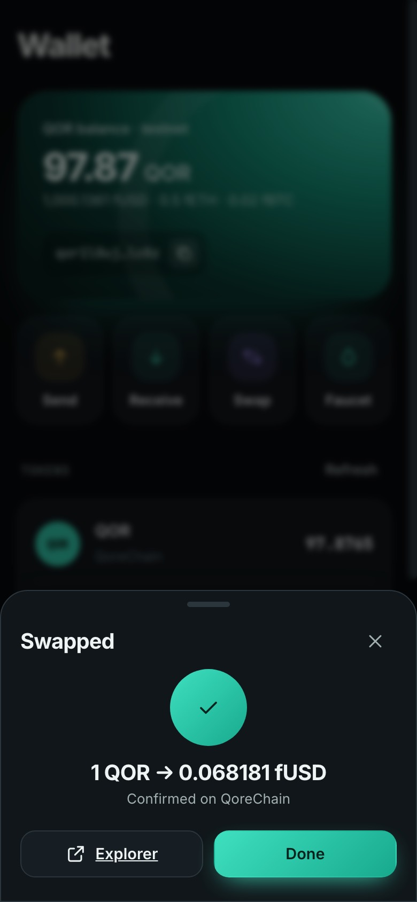
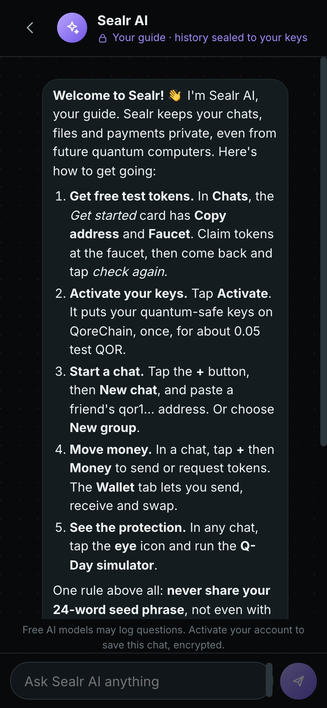
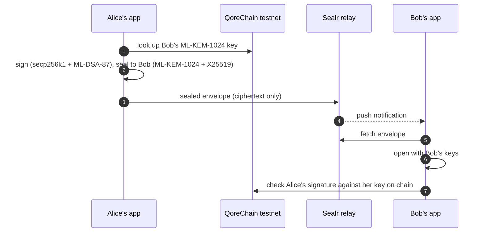

<div align="center">



<br>

[](https://explore.qore.network)
[](#-how-a-message-is-sealed)
[](#-how-a-message-is-sealed)
[](#-run-it)
[](LICENSE)

**[Why](#-why-sealr)** · **[Screens](#-a-look-inside)** · **[Q-Day simulation](#-the-q-day-simulation)** · **[Proof on chain](#-proof-on-chain)** · **[How it works](#-how-a-message-is-sealed)** · **[Run it](#-run-it)**

<sub>Built for <b>QoreChain · Build Before Q-Day</b>. Testnet only. Do not use real funds.</sub>

</div>

---

## 🔓 Why Sealr

Every encrypted chat you send today can be **recorded now and decrypted later**, the day a large quantum computer can break the key exchange it relies on. That day has a name: **Q-Day**. Messages, photos and payment details sent today are already exposed to it.

**Sealr** is a messenger and wallet in one app where everything is sealed with post-quantum cryptography from the start:

<table>
<tr>
<td width="33%" valign="top">

### 💬 Sealed chat & files
Every message and photo is signed by the sender and sealed to each recipient with **ML-KEM-1024 + X25519**. The relay only ever stores ciphertext.

</td>
<td width="33%" valign="top">

### 🪪 Wallet = identity
One seed phrase gives you an address, an **ML-DSA-87** signing key and an **ML-KEM-1024** sealing key, registered on QoreChain. Senders are verified against the chain, not the server.

</td>
<td width="33%" valign="top">

### 💸 Money in the chat
Request QOR, pay a request, or swap, without leaving the conversation. Every transaction is **hybrid-signed** (classical + post-quantum).

</td>
</tr>
<tr>
<td valign="top">

### 👥 Groups with real removal
Each group message is sealed separately for every current member, so there is no shared group key. Once someone is removed, they are simply no longer a recipient: their app shows the next message as **locked**.

</td>
<td valign="top">

### ⚛️ Q-Day simulation
Hand an attacker a quantum computer and watch what happens to the same message in a classical app and in Sealr. Real cryptography, not an animation. [More below](#-the-q-day-simulation).

</td>
<td valign="top">

### 📱 Feels like an app
Installs as a PWA with push notifications, a password-locked seed vault and **Sealr AI**, a built-in guide for first-time users.

</td>
</tr>
</table>

---

## 📸 A look inside

<div align="center">
<table>
<tr>
<td align="center"><br><sub><b>Sealed photo</b></sub></td>
<td align="center"><br><sub><b>Pay in the chat</b></sub></td>
<td align="center"><br><sub><b>Removed = locked out</b></sub></td>
</tr>
<tr>
<td align="center"><br><sub><b>Q-Day simulation</b></sub></td>
<td align="center"><br><sub><b>Hybrid-signed swap</b></sub></td>
<td align="center"><br><sub><b>Sealr AI guide</b></sub></td>
</tr>
</table>
</div>

---

## ⚛️ The Q-Day simulation

> **Our original feature.** Most "quantum-safe" demos are slides. This one runs real cryptography in your browser.

1. The same message is encrypted two ways: the way most messengers do it today (**X25519 + AES-GCM**), and the way Sealr does it (**ML-KEM-1024 + X25519**, via QoreSeal).
2. The attacker is handed the **X25519 private key**, which is exactly what Shor's algorithm on a quantum computer would recover.
3. The attacker tries to open both.

| | Today's messenger | Sealr |
|---|:---:|:---:|
| Key exchange | X25519 | ML-KEM-1024 **+** X25519 |
| Attacker holds the X25519 key | 🔓 **Opened.** Message read in full | 🔒 **Still sealed.** ML-KEM-1024 can't be recovered |

The live version in the app runs this on messages you actually sent. Source: [`client/src/qday.js`](client/src/qday.js).

---

## ⛓️ Proof on chain

| What | Where |
|---|---|
| Hybrid-signed swap on QoreChain testnet | [`4EB34A4AEC642CB6356F86AEF89D49BDD8AA06E1CB7C6CC614EDC0EF12352552`](https://explore.qore.network) <sub>(switch the explorer to <b>Testnet</b>)</sub> |
| Every user's ML-DSA-87 and ML-KEM-1024 keys | Registered on chain once at sign-up, looked up by address |
| Reproduce it yourself | `npm run proof` |

`npm run proof` runs the whole story against testnet and checks each step:

1. Alice, Bob and Carol register their post-quantum keys on chain (and Alice funds Carol with a hybrid-signed transfer if needed).
2. Alice signs a message and seals it to Bob and Carol, using keys read from the chain.
3. Bob and Carol open it and verify Alice's signature against her ML-DSA-87 key on chain.
4. Alice, who is not a recipient, cannot open the envelope.
5. Carol is removed from a group of three; the key rotates, Bob can open the new key and Carol cannot.

---

## 🔐 How a message is sealed



The relay never sees plaintext, never holds keys, and can't forge a sender: verification happens against the chain.

<details>
<summary><b>Project layout</b></summary>

| Path | What it is |
|---|---|
| [`lib/chain.mjs`](lib/chain.mjs) | Accounts from a mnemonic, hybrid-signed transactions, one-time key registration, pools, quotes and swaps |
| [`client/src/sealr.js`](client/src/sealr.js) | Everything that isn't UI: wallet, sealing and opening, groups, payments, relay |
| [`client/src/qday.js`](client/src/qday.js) | The Q-Day simulation |
| [`client/src/vault.js`](client/src/vault.js) | The seed phrase at rest: scrypt + AES-256-GCM, in this browser only |
| [`server.mjs`](server.mjs) | The relay: serves the app, proxies chain requests, stores envelopes it can't read |
| [`scripts/proof.mjs`](scripts/proof.mjs) | End-to-end proof on testnet (`--offline` skips the chain) |
| [`scripts/wallet.mjs`](scripts/wallet.mjs) | Makes throwaway testnet accounts, saves mnemonics to `.env`, prints only addresses |
| [`assets/video/`](assets/video) | Scripts and stills used to build the demo video |

</details>

---

## 🚀 Run it

Requires **Node 20+**.

```bash
git clone https://github.com/BernardOnuh/sealr && cd sealr
npm install
npm run wallet     # throwaway testnet accounts → .env (never commit it)
npm start          # builds the client and serves it at http://127.0.0.1:8900
```

Then claim test QOR from the QoreChain faucet for your address and send your first sealed message.

<details>
<summary><b>Environment variables (all optional)</b></summary>

| Variable | Default | Purpose |
|---|---|---|
| `OPENROUTER_API_KEY` | none | Enables Sealr AI |
| `QORE_REST` | `https://api-testnet.qore.host` | Chain REST endpoint |
| `QORE_CHAIN_ID` | `qorechain-diana` | Chain ID (mainnet is refused) |
| `PORT` / `HOST` | `8900` / `127.0.0.1` | Where the relay listens |
| `DATA_DIR` | `./data` | Where sealed envelopes are stored |

</details>

---

## ⚖️ Honest limits

- **Testnet only.** The app refuses to run on mainnet.
- **Metadata is visible to the relay.** It sees who messages whom and when, but not what.
- **Your password protects your seed in this browser.** Lose both and the account can't be recovered.

## 🙏 Credits

Sealr is built on these kits, libraries and services. Thank you to their authors.

| Used for | Credit |
|---|---|
| Hybrid signing, PQ key registration, message signatures | [`@qorechain/qoresign`](https://www.npmjs.com/package/@qorechain/qoresign) (QoreChain kit) |
| ML-KEM-1024 + X25519 sealing, recipient cards, group epoch keys | [`@qorechain/qoreseal`](https://www.npmjs.com/package/@qorechain/qoreseal) (QoreChain kit) |
| Transaction encoding | [CosmJS](https://github.com/cosmos/cosmjs) (`@cosmjs/amino`, `@cosmjs/proto-signing`) and [`cosmjs-types`](https://github.com/confio/cosmjs-types) |
| Q-Day simulation, seed vault | [`@noble/curves`](https://github.com/paulmillr/noble-curves), [`@noble/ciphers`](https://github.com/paulmillr/noble-ciphers), [`@noble/hashes`](https://github.com/paulmillr/noble-hashes) |
| Seed phrases, encoding | [`@scure/bip39`](https://github.com/paulmillr/scure-bip39), [`@scure/base`](https://github.com/paulmillr/scure-base) |
| App and build | [React](https://react.dev), [Vite](https://vitejs.dev), [esbuild](https://esbuild.github.io) |
| Relay | [`web-push`](https://github.com/web-push-libs/web-push), [`undici`](https://github.com/nodejs/undici), [`qrcode`](https://github.com/soldair/node-qrcode) |
| Sealr AI | Free models through [OpenRouter](https://openrouter.ai) |
| Walkthrough narration | [ElevenLabs](https://elevenlabs.io) text-to-speech |
| Network | [QoreChain](https://qorechain.io) testnet `qorechain-diana`, faucet and explorer |


## 📄 Licence

[MIT](LICENSE)

<div align="center"><br><br><sub>Sealed today. Still sealed after Q-Day.</sub></div>
